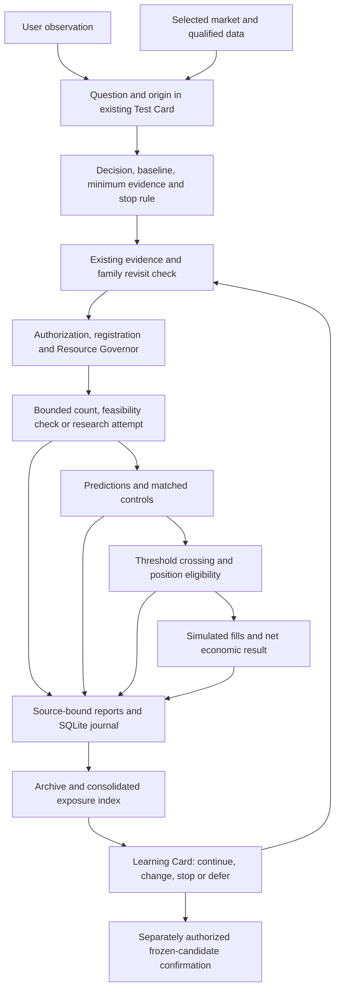

# AQRS architecture

**Version boundary:** This document mostly describes the target architecture for the **first walking skeleton**. The binding **v1.0 product state** is in [`PRODUCT_VISION.md`](PRODUCT_VISION.md), and all milestone acceptance gates are in [`MILESTONE_DOD.md`](MILESTONE_DOD.md). The later features described here are **not** an instruction to implement them in v0.1.

## Current research value stream

**Start here for people and LLMs.** M0 and M1 are accepted; M2 is in progress.
The current workflow combines the core CLI, bounded pilot entries and human
or agent orchestration under the existing queue. It is not yet the adaptive
M3 scheduler or the independent M4 confirmation system. Current acceptance,
authorization and next actions live in the
[experiment queue](MILESTONE_STATUS.md#experiment-queue).



An initial observation and market-first discovery are both valid entry paths.
The latter's proposed Scout remains subject to M2-E21's start conditions.
Counts and training-only feasibility checks can end before predictions.
No branch creates broker orders. The protected final holdout never feeds
the learning/priority loop; confirmation needs its separate isolation gate.

| Handoff | Existing record and responsibility | Information that must survive |
|---|---|---|
| Origin to research question | Owner/Quant Research; [Test Card](MILESTONE_STATUS.md), [requirements](requirements/REQUIREMENTS.md) | Origin, parent question or explicit unknown, baseline, intended decision, eligible population and revisit trigger |
| Question to admitted attempt | Published definition/card, [research protocol](RESEARCH_PROTOCOL.md), [Governor](RESOURCE_GOVERNOR.md), pilot entry | Variant versus attempt identity, authorized data, source/configuration binding, budget and stop condition |
| Attempt to evidence | `src/aqrs/journal.py`, report and saved source | Every failed, screened, aborted and completed attempt; predictive, execution and economic conclusions separately |
| Evidence to recoverable exposure | [archive utility](../scripts/evidence_archive.py), [exposure index](../evidence/exposure.json), original archives/receipts | Original IDs, data reuse, all recorded diagnostic views, source location and unknown history |
| Evidence to learning and next decision | Existing Learning Card and queue; Quant Research/owner | Result, scoped disposition, missing evidence, default while deferred and observable revisit condition |

The journal is the execution record. The index is its derived cross-campaign
audit view with existing registration and manual-screen metadata. Learning
and prioritization remain in the canonical cards and queue; no second
scheduler, hypothesis database or independent-evidence counter is introduced.
Index `lineage` fields provide navigation to those records, not new historical
preregistration. Unknown origins or missing execution-time source bindings
remain unknown. Most variant definitions are compared directly with archived
configuration signatures. E19's two original hand-authored declarations are
retained with their pinned Git reference and an accidental-edit digest; that
digest is not independent authentication. Their separately verified journal
signatures retain the inherited configuration defaults without substituting
those defaults for the declared market experiment.

### Exposure maintenance and interpretation

Run `python scripts/evidence_archive.py --verify-exposure` to compare the
entire index with the digest-bound SQLite snapshots in `archive_sources`.
After recording a new independently verified archive source, run
`--consolidate-exposure` and then `--verify-exposure`. Consolidation updates
only `evidence/exposure.json`, validates before replacement and refuses to
drop existing attempts without their sources. Keep its source inventory and
receipt links in the same index. `--build` is the legacy local archive creator;
it refuses to overwrite an index with frozen archive sources. Do not use it
to refresh the consolidated history.

Flat `diagnostic_exposure` and `result.diagnostic_exposure` are both supported.
Identical mirrored lists count once; conflicting lists fail visibly. Empty
means explicitly no recorded views, while an absent field means the legacy
record does not supply that inventory. Each replay retains its own looks.
Registration totals and manual-screen attempt links are references to those
attempts and must not be added again. Current index coverage is bounded by
the listed archives; it does not prove that all historical manual looks are
known. Report-based precision planning and training-only observations remain
separate records, not invented outcome trials.

| Example chain | Meaning and current learning boundary |
|---|---|
| E08 → E09 → E20-P04 | One fixed LightGBM/Ridge question. Corrected and source-bound platform replays retain separate attempt IDs and diagnostic exposure. P04 does not repair the original execution-time source gap or supply independent alpha evidence. |
| E14 → E17 → E18 | Two interpretable questions; E17 qualifies a training window, then E18 evaluates the same question families on that development window. Feasibility is not predictive value; the E18 candidates remain deferred under their recorded screens. |
| E18 → E19 | A new HMM-versus-simple-gate question motivated by the positive-move baseline, using the same December dates. The relation is reuse plus a new question, not an independent replication. |
| E15 | State lifetime coverage on reused dates, linked to its journal attempt and manual registration. A coverage pass is not an economic outcome. |

M2-E20 still needs an eligible ordered contrast with justified dependence and
precision. Restoring provenance and diagnostic views supplies no missing
forecast loss sequence or independent observations. See the
[capacity and forecast follow-up](MILESTONE_ARCHIVE.md#m2-e20-capacity-and-forecast-evidence-follow-up).
Before a future authorized comparison, select the smallest evidence retention
that can answer its decision using the [retention contract](CONTRACTS.md#prospective-retention-selected-from-the-research-decision).

Methodological basis: retaining the exact route from inputs to reported
results follows [Sandve et al. (2013)](https://doi.org/10.1371/journal.pcbi.1003285).
Keeping exploratory origins distinct from prospective tests follows
[Nosek et al. (2018)](https://doi.org/10.1073/pnas.1708274114). These principles
support traceability; they do not validate AQRS's financial hypotheses.

## Design vision

**Models are modular without excessive abstraction.** From M2/v0.3, supervised discovery (LightGBM challenger) and unsupervised discovery (Isolation Forest scores subjected to separate future-return tests) must be able to use the same research runner. HDBSCAN, autoencoders, PCA, HMMs, DeepLOB, transformers, LLM/FinBERT and GNNs remain data/budget-dependent catalog candidates. [`MODEL_TOOL_CATALOG.md`](MODEL_TOOL_CATALOG.md) and [`MODEL_EVALUATION_PROTOCOL.md`](MODEL_EVALUATION_PROTOCOL.md) provide prerequisite, timing, cost and trial contracts. **Do not build a generic plug-in framework for M0**; add a lightweight adapter only when a second model family truly needs it.

The target is **a small, tested research instrument instead of a large unfinished trading platform**. M0 modules form one executable vertical workflow. Abstractions should be introduced only when this workflow needs them.

```text
          Research goal / constraints (Backward Planning)
                             |
                     Candidate registry
                             |
                      Research Manager
                    (deterministic in M0)
                             |
             Resource Governor preflight / budgets
                             |
                 Feasibility / early cost gate <--- Data quality + cost assumptions
                             |
                Authorized forward research runner
                             |
           +-----------------+------------------+
           |                 |                  |
         Features         Candidates         Benchmarks
           |                 |                  |
           +-----------------+------------------+
                             |
                  Walk-forward research folds
                             |
                   Prediction evaluation
                             |
                    Decision + net PnL
                             |
               Conditional controls / report
                             |
                SQLite Research Journal + reports
                             |
                   Research-only feedback
                             |
                       Research Manager

   ISOLATED: FINAL HOLDOUT (never used for research feedback)
   FUTURE: Shadow/paper monitoring (no broker orders without new explicit authorization)
```

## v0.1 module responsibilities and flow

| Module | Inputs | Outputs | Core rule |
|---|---|---|---|
| `config` | YAML | Validated parameters and fingerprint | Fail fast on implausible settings. |
| `data` | Seed, scenario, bar interval | OHLCV bars and data manifest | Monotonic unique timestamps. |
| `features` | Historical bars | Feature frame with `available_at` | Only data through close of `t`. |
| `candidates`/`discovery` | Features and target contract | Versioned candidate | Train exclusively on training data. |
| `costs` | Instrument/cost assumptions | Round-trip cost model | Distinguish fees, spread and slippage; no double counting. |
| `validation` | Candidate and time series | Chronological folds/predictions | Remove label overlap across boundaries. |
| `benchmarks` | Same data/folds | Predictive and trading controls | Fair matching horizon, fills and costs. |
| `decisions` | OOS prediction, current position, costs | `long`/`short`/`flat` decision | Allow flat when net evidence is inadequate. |
| `backtest` | Decision, bars, fill rule, costs | Trades and net PnL | No action before signal availability. |
| `research_manager` | Candidates, journal evidence | Next attempt and reason | Final holdout excluded from feedback. |
| `resource_governor` | Proposed trial plan, budget, pilot metrics | Admit/reject plus supervised worker outcome | Enforce trial/fit/wall/memory/concurrency bounds. |
| `journal` | Runs, attempt states, results | SQLite records + artifact references | Durable history including failures. |
| `reporting` | Results and provenance | `report.json`, `report.md` | Synthetic output clearly labeled. |
| `cli` | `research plan/run --config` | Whole orchestration | One real runnable command. |

These names suggest responsibilities, **not** a requirement for fourteen empty files. Codex may combine modules in a few small files while preserving testable boundaries.

## v0.1 runtime sequence

The isolated `blind_input.py` and `blind_search.py` entry implements AQRS-B01's
external-synthetic delivery and fixed rule diagnostic. It reuses `config.load`,
`governor.supervise`, `worker.run`/fit reservations, the native platform adapter,
`journal` and atomic storage. Input qualification and six shared quantile
calibrations run in one preparation worker; each research candidate gets its
own supervised worker. Reuse `provenance.snapshot` to bind worker execution to
copies of every package module, checked before and after each worker rather
than importing the mutable working tree. A remotely verified preregistration barrier separates
preparation from outcome measurement. It does not change the core market CLI,
data contracts or reserved day. No generic framework or discovery service is
introduced. The exact statistical scope is in the research protocol, section 11.


1. Validate configuration; create run ID and fingerprint.
2. Generate deterministic synthetic bars and store a dataset fingerprint.
3. Check data quality; abort before training if invalid.
4. Register **at least two** candidate hypotheses (e.g. Ridge using lag returns; Ridge adding volume and volatility), without presuming a winner.
5. Research Manager assigns explainable priority and requests compute within its approved budget.
6. Resource Governor counts projected fits/trials and benchmarks a bounded pilot; admit or reject before expensive work.
7. Perform an early cost and data-plausibility check. `DEFERRED`/`INSUFFICIENT_EVIDENCE` is appropriate where evidence is weak.
8. Create chronological research folds; fit all applicable feature transformers and models on each fold's training subset and obtain OOS predictions.
9. Evaluate predictive and trading baselines on matching folds and cost assumptions.
10. Convert OOS predictions to `long`, `short` or `flat` through a documented heuristic; execute after the information becomes available. Apply entry/exit and any turnover costs.
11. Report net results, trade count, turnover and basic risk measures; optionally include a lean ablation with fewer features.
12. Persist all attempts, configs, fold outcomes, failures and resource stops; research priority uses **eligible** outcomes only.
13. Write `report.json` and `report.md`. Never present synthetic results as live evidence.

The implementation uses `research.py` for the fixed candidate schedule, `evaluation.py` for the
Ridge and matched controls, `market.py` for the timing contract, and `journal.py` for SQLite.
The manager writes a research-only bar prefix for evaluation workers. The complete synthetic
dataset is an audit artifact. Journal reservations precede worker authorization. A repeated
manual run links to prior attempts and retains its own execution outcome.

## Implemented M1 real-data path

The count-only `events.py` module provides the fixed `PRICE_DROP_V2` rule over
caller-validated minute closes. It reads no files and evaluates no forward
returns; a future real-data entry must reuse importer, admission and journal
controls. The legacy scanner remains an immutable evidence input.

The `research precision` CLI action reuses `planning.py` for scalar conditional
normal-mean calculations without configuration loading, market access, model
fits or campaign creation. It is separate from Governor admission. Current
evaluation reports label sparse trading and screen/benchmark limitations; the
Isolation Forest report reuses the simulator for a complete hourly opportunity
diagnostic without changing its historical paired decision rule.

The Binance Spot adapter validates a local daily archive and checksum before producing the same
`Bars` input used by the synthetic workflow. The existing research runner uses the shared
features, folds, evaluator, Governor and journal. For the accepted BTCUSDT scope, the next UTC
day is a reserved interval in the manifest. Evaluation workers receive only the research day.
See the [M1 acceptance evidence](MILESTONE_ARCHIVE.md#m1-e11-learning-card-and-m1-acceptance-2026-11-09).

The optional `spot_dataset` data-only entry reuses `binance_spot_pilot.load_spot_day`,
`Bars`, `write_dataset`, `provenance.snapshot` and the existing supervisor/worker
handshake. A fixed scope determines symbol/date URLs before access. Sequential
contained workers acquire or read archives, verify the published checksum and
complete UTC cadence, and join days within each symbol. Activity fields have a
separate timestamp-aligned file and digest; the existing six-column `Bars`
contract and M1 import wrapper remain compatible. The entry records no model
fits or economic diagnostics, and does not route these new datasets into an
existing research campaign. Optional network access is confined to `acquire`;
the core research CLI and `qualify` remain offline.

## Time semantics — binding contract

For v0.1, bars have UTC `bar_open_time` and `bar_close_time` and feature vector `X_t` becomes available **only after bar `t` closes**.

**Reference convention:**

- Decision after `close[t]`.
- Earliest simulated fill: `open[t+1]`, not allowed in features.
- Fixed holding horizon of `h` bars; exit at `open[t+h+1]`.
- Research target: `open[t+h+1] / open[t+1] - 1` as simple return (the implementation/report must agree). A log return can be a separately documented alternative, not an undocumented substitution.
- For `h=3` the position runs `open[t+1]` to `open[t+4]`, not “next three closes” with a fill at `close[t]`.
- Final `h+1` signal rows lack valid labels without later opens and must be dropped.

Using `open[t+1]` as both a fill price and an input to the signal would violate causality. Model fees/spread/slippage separately from the reference open. OHLCV bar backtests are approximate; they cannot establish limit-order fill probability.

## Validation layers

```text
Time ───────────────────────────────────────────────────────────────────►
[Training][Research Val 1][Expanded Training][Research Val 2] ... [FINAL HOLDOUT]
         ^ permitted research feedback                             ^ isolated;
           to Research Manager                                       NO feedback
```

- Training and research validation are strictly chronological.
- With `h>1`, purge training examples near each boundary or insert enough gap so their target period cannot extend into validation.
- Fit scaler/imputer on each training subset only.
- v0.1 reserves a final interval and blocks feedback. Its real-world statistical meaning on synthetic data is nil.
- Reusing a final holdout as an optimization signal destroys independence.

## Future architecture — NOT M0 scope

**Market Selector:** choose asset, venue and horizon from economics, data and competition. **Advanced Alpha Discovery:** supervised predictive mining, regime/residual structures, possibly order-book/order-flow data. **Experiment Scheduler:** staged tests, Successive Halving, Bayesian Optimization/bandits with conservative allocations. **Scientific Validation:** matched placebos, block permutations, multiple-testing correction, effective sample size. **Alpha Monitoring:** new-data shadow/paper forecasts, drift, execution deterioration and precommitted pause/review. **Advanced Decision:** risk-constrained net optimization/MPC and RL only after separate evidence. **Execution Connector:** any live broker integration is an entirely separate authorization, never implicit in research software.

## Compute Budget First — cross-cutting control from M0

The **Resource Governor** operates between Research Manager and computational workers. **Forward execution requires budget approval**:

`Research Manager → Preflight (fits/trials/seeds/folds + pilot wall time/RAM) → Resource Governor (admit/reject) → isolated worker under watchdog → SQLite resource/evidence journal → report`.

- **M0:** minimal **enforced** per-trial/campaign wall, memory, fit, trial and concurrency limits. Preflight is mandatory.
- **M3:** adaptive research may allocate approved budget across families, **never increase it autonomously**.
- **M4:** statistical validation consumes the same explicit bounded budget; extra CV/bootstrap is not free.
- **M7–M9:** reference hardware, crash/restart tests, preflight estimate accuracy and rejection test for multi-year calibration.

Resource stops are **execution outcomes**, not alpha evidence. No recursive auto-retrain loop. Full contract: [`RESOURCE_GOVERNOR.md`](RESOURCE_GOVERNOR.md); risk list: [`RISK_REGISTER.md`](RISK_REGISTER.md).

## English, Windows/Linux and cloud-neutral design constraints

All interfaces, serialized metadata and reports are English. The developer's **native Windows computer is the primary local target**, with a tested **headless Linux target** from M0. Keep the research engine and scientific contracts independent of OS and hosting provider. Use `pathlib`, UTC, virtualenv packaging, configurable artifact paths, and no mandatory WSL, Docker, GUI, admin/root, GPU or runtime network access. Place OS-specific worker-tree control and memory guards behind a narrow adapter; independently test on Windows and Linux and fail closed if a required resource guarantee is unavailable. Avoid a cloud-specific database, filesystem, scheduler or API in the core; a future Hetzner or other Linux-server deployment should need installation/configuration, not a core rewrite. Do **not** implement provider integrations or a plugin framework in M0. See [`PLATFORM_COMPATIBILITY.md`](PLATFORM_COMPATIBILITY.md).

## Evidence before magic

Traceability of **what information existed when**, **why an attempt was chosen**, **which costs were charged**, **which baseline it beat**, and **which compute it consumed** takes precedence over model count and raw throughput.

## Audit remediation implementation

The existing supervisor also contains core data preparation. `research.prepare_data` imports/generates and stages the prefix after static admission and before fitting. Core timing and trial workers execute saved source. `provenance.snapshot` is shared by the core and pilots. SQLite remains the runtime journal; the versioned exposure index is an audit projection, not a second scheduler. Evidence archives use SQLite backup snapshots. See the [execution boundary](../README.md#auditable-evidence-and-execution-boundaries) for deadline and historical-evidence limits.
